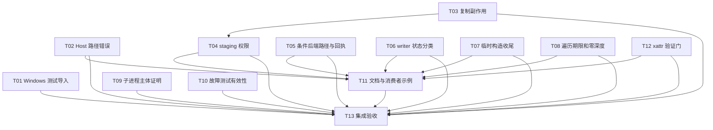

# rs-local-files 本轮评审修复实施计划

> **面向智能体执行者：** 收到实施指令后使用 `executing-plans` 逐项实施，以复选框记录进度；用户明确选择并行智能体时可使用 `subagent-driven-development`。本文件本身不是开始实施、提交或推送的授权。

**目标：** 用局部修复落实 RLF-01—RLF-15，并对 RLF-Q01 先验证、证实后再修复。

**架构：** 保留 Host／Rooted 分层和公共 API；在内部记录真实副作用、调整 staging 权限提交顺序、修正条件写坐标和 receipt，补强回归与消费者文档验证。

**技术栈：** Rust 1.94、edition 2024、现有 qubit-io／budget、libc／windows-sys、tempfile 和 test-support。无依赖升级。

**设计依据：** [本轮设计](design-20261024T081615336Z-9b660ae2.md)。

**工作位置：** `/data/working/qubit/rust-common/rs-local-files`，继续使用当前 Paseo workspace。本计划按用户指定路径保存在项目 doc 目录，不创建技能默认的临时方案工作区。

## 全局约束与采纳范围

- 用户没有逐项限定本轮采纳范围；默认纳入最终评审报告 RLF-01—RLF-15。没有用户明确搁置或拒绝的条目。方案纳入不等于用户逐条认可诊断。
- RLF-Q01 是待验证疑点；T12 未证实前不得按缺陷修复或计入“已修复”。不得顺带纳入其他未编号候选或机械风格清理。
- 当前阶段仅新建用户指定的设计及计划文件；以下复选框均为未来实施动作，本阶段不执行。
- 后续实施需有用户的实施指令。未经明确授权不执行 `git add`、`git commit`、`git push`、远端写操作，不把“检查点”解释为必须提交。
- 不创建或打开新的 Paseo workspace，不主动移动、重命名或删除现有重要文件；只清理本轮专属的可丢弃测试产物。
- 以含未提交修改的当前工作树为基线；设计第 1 节列出的内容及实施前新增用户改动都必须保留。不得 reset、restore、覆盖它们。
- 保持公共 API、默认 feature 集、MSRV `1.94`、edition `2024` 和依赖版本。若实现证据要求公共破坏性变更，先说明具体必要性和调用方迁移，不能擅自改公共签名。
- 准备修改源码/测试时再读取适用 Rust、Rustdoc、测试、bug-fix 规则；修改脚本或 Git 状态时读取对应按需规则。不要为本次文档编写遍历无关规则。
- 用确定性故障注入和真实磁盘状态验证，禁止用单纯 `is_err()`、未进入主体的子进程成功或不可见的 feature 空分支作为通过依据。
- 生产 Rustdoc 使用英文；README、指南和既有双语设计的相关合同同步。只更新本轮相关部分，不全库格式化或拆类。

## 纳入项、搁置项与任务映射

| 条目 | 实施任务 | 验收归属 |
| --- | --- | --- |
| RLF-01 路径 panic | T02 | T02 回归、T13 Host 集成 |
| RLF-02 删除后误报未变 | T03 | T03 副作用矩阵、T13 下游映射 |
| RLF-03 权限发布顺序 | T04 | T04 顺序与失败窗口、T13 平台验证 |
| RLF-04 Windows Path 导入 | T01 | T01 Windows 编译、T13 原生测试 |
| RLF-05 恢复路径坐标 | T05 | T05 非根 PWD 恢复 |
| RLF-06 发布方法误报 | T05 | T05 fake receipt 与 Windows Host |
| RLF-07 InvalidState reason | T06 | T06 生命周期矩阵 |
| RLF-08 临时构造泄漏 | T07 | T07 身份失败、清理失败 |
| RLF-09 deadline 内循环 | T08 | T08 扫描中途到期 |
| RLF-10 零深度枚举 | T08 | T08 无读取／无 seen 增量 |
| RLF-11 子进程零用例 | T09 | T09 完整名称及完成 sentinel |
| RLF-12 失败测试缺口 | T10 | T10 恢复状态矩阵及 strace 探针 |
| RLF-13 消费者 cfg 上下文 | T11 | T11 独立 consumer 实际运行 |
| RLF-14 API 文档 | T11 | T11 Rustdoc 与 docs.rs 等效构建 |
| RLF-15 示例隔离及失效路径 | T11 | T11 可执行 doctest |
| RLF-Q01 xattr 疑点 | T12，先验证 | T12 证实/否定/未验证证据 |

用户明确搁置或拒绝：无。RLF-Q01 的验证门不是用户拒绝，也不是默认授权修复一个尚未成立的缺陷。

## 调度图

工作树中的检查点不要求 Git commit。批次 A 的写入集合互不相交，可并行开展；当前执行者可顺序执行，只有获得相应委派授权时才派发智能体。所有本地 Cargo 命令共用资源组 `cargo-main`，同一 target/cache 上的重型命令串行；独立阅读和编辑不受此限制。不要通过额外 checkout/workspace 实现并行。

| 任务/批次 | 前置任务 | 最小解锁产物 | 写入集合（相对仓库） | 本地验证 | 集成验证归属 | 审查时机 |
| --- | --- | --- | --- | --- | --- | --- |
| T01/A | 无 | 两处 import 正确 | 两个 Windows 导入测试文件 | Windows 两目标 no-run | T13 | 批量 |
| T02/A | 无 | 路径 helper 不断言外部输入 | path_management.rs；新 Host 路径回归文件 | 指定路径回归 target | T13 | 立即 |
| T03/A | 无 | typed 删除事实与 copy state 提示稳定 | root.rs；copy destination/symlink/file；内部 copy error；公共 failure；新状态回归文件 | 指定状态回归 target | T13 | 立即 |
| T04/B | T03 | file.rs 的副作用合并已稳定 | rooted/copy/file.rs；local_root_atomic_writer.rs；新权限顺序回归文件 | 指定权限回归 target | T13 | 立即 |
| T05/A | 无 | 三坐标与 native receipt 一致 | conditional 后端/namespace/commit；两层 conditional facade；新后端合同测试 | 条件后端合同 target | T13 | 立即 |
| T06/A | 无 | 生命周期分类一致 | local_conditional_writer.rs；conditional_writer_tests.rs | 生命周期过滤测试 | T13 | 批量 |
| T07/A | 无 | Host 完整构造失败统一收尾 | host temp.rs；temp_entry_identity.rs；新构造失败测试 | 临时构造故障 target | T13 | 立即 |
| T08/A | 无 | 内循环期限和空遍历有观测证据 | walker.rs；walk internal 状态；walker policy tests | walker policy target | T13 | 立即 |
| T09/A | 无 | CWD 子进程完成证明 | tests/temp/local_temp_directory_tests.rs | lib_tests 中两个场景 | T13 | 批量 |
| T10/A | 无 | 故障预期矩阵和独立 trace 探针 | local_file_writer_failure_tests.rs；local_file_system_tests.rs | 两个测试 target 的过滤用例 | T13 | 批量 |
| T11/C | T02、T04、T05、T06、T07、T08、T12 | 最终行为与疑点状态已确定 | Cargo.toml；六份既有文档；指定类型/入口 Rustdoc；新 consumer 测试 | doctest、consumer、digest doc | T13 | 立即 |
| T12/A | 无 | xattr 时序得到证实/否定/缺环境记录 | linux_android.rs（仅证实后改生产逻辑）；必要 inline 私有测试 | 原生序列与私有回归 | T13 | 立即 |
| T13/D | T01—T12 | 全部任务的可审查增量与证据 | 本设计/计划的实际结果记录；仅必要的已列路径回修 | 统一完整验收 | T13 | 立即 |

T03→T04 同时解决共享 `file.rs` 的写入冲突；T11 等待行为任务稳定后才写合同。并行批次不是允许两个任务同时运行共用 target 的 Cargo。T12 缺验证环境时须提交明确的“未验证”结论供 T11/T13 使用，无须让其他条目无限等待。

## 任务拓扑依赖图



## 执行前检查

- [ ] 在目标仓库运行 `git status --short`、`git diff --stat`，保存已有改动的只读快照/哈希，核对设计第 1 节；不把已有修改撤回到 HEAD。
- [ ] 确认用户已下达实施指令，读取项目当前指令及适用按需规则；以下任务不自动包含提交、推送或新增 workspace。
- [ ] 核对 `rust-toolchain.toml`、`Cargo.toml`、当前可用平台和现有故障机制。记录平台缺口；不要升级 toolchain 或依赖来绕过本轮问题。
- [ ] 基线测试只运行与将修改行为直接相关的 target；记录原有失败。全量测试、Clippy、Rustdoc/fuzz 编译由 T13 汇总；T11 自身的高风险示例必须先局部验收。

## T01：修正 Windows 测试导入（RLF-04）

**文件：** `tests/rooted_lifecycle_tests.rs`；`tests/local/internal/host_local_file_system/path_resolution_tests.rs`。

**接口：** 无生产 API 改动。前者 `Path` 跨平台导入；后者保留 `cfg(any(unix, windows))`，去掉额外的 Unix gate。输出是 Windows 可以编译的现有测试目标。

- [ ] 将两处导入调整为实际使用范围；不改变测试函数的平台 gate：

```rust
// rooted_lifecycle_tests.rs
use std::path::Path;

// path_resolution_tests.rs
#[cfg(any(unix, windows))]
use std::path::Path;
```

- [ ] 在 Windows 运行 `cargo test --locked --all-features --test rooted_lifecycle_tests --test lib_tests --no-run`。预期两个目标均能编译，不再出现未声明 `Path`。非 Windows 本机只可先验证其本机分支，不能标记 Windows 验收通过。
- [ ] 审查 diff 只涉及 import gate；T13 运行 Windows 原生用例。

## T02：消除 Host 树复制路径 panic（RLF-01）

**文件：** 修改 `src/local/internal/path_operations/path_management.rs`；新建 `tests/host_copy_path_boundary_tests.rs`。

**输入/输出：** 保持 `canonicalize_existing_prefix(&Path) -> io::Result<PathBuf>`。失败仍经现有公共 copy failure 返回；无新增签名。

- [ ] 加入 Unix 公共回归：源目录存在，目标 `missing/../output`。核心测试如下，导入按项目规范逐对象排列：

```rust
#[cfg(unix)]
#[test]
fn test_tree_copy_rejects_missing_parent_before_dotdot_without_panicking() {
    let work = tempfile::tempdir().expect("isolated fixture");
    let source = work.path().join("source");
    std::fs::create_dir(&source).expect("source");
    std::fs::write(source.join("payload"), b"A").expect("payload");
    let destination = work.path().join("missing/../output");
    let filesystem = qubit_local_files::LocalFileSystem::host().expect("host");
    let failure = filesystem
        .copy_with_options(
            &source,
            &destination,
            &qubit_local_files::options::LocalCopyOptions::new().with_tree_source(),
        )
        .expect_err("native traversal through a missing parent must fail");
    assert_eq!(failure.state(), qubit_local_files::outcome::LocalCopyFailureState::Unchanged);
    assert!(!work.path().join("missing").exists());
    assert!(!work.path().join("output").exists());
    assert_eq!(std::fs::read(source.join("payload")).unwrap(), b"A");
}
```

- [ ] 运行 `cargo test --locked --test host_copy_path_boundary_tests`，确认旧实现以 panic 失败，而不是 fixture 设置失败。
- [ ] 用 `ok_or_else`/明确 match 替代 `expect`，处理无法向父目录推进；不能先 normalize `..`。正常名称继续原有 canonicalize-prefix 算法。
- [ ] 同 target 补对照：普通缺失尾可创建；存在父目录后的 `..` 保持原生语义；链接后的 `..` 不被词法折叠。再次运行该 target，全部通过；检查错误带原请求路径。

## T03：保留复制准备阶段的删除副作用（RLF-02）

**文件：** `src/local/local_copy_dir_error.rs`、`src/outcome/local_copy_failure.rs`、`src/rooted/root.rs`、`src/rooted/copy/destination.rs`、`src/rooted/copy/symlink.rs`、`src/rooted/copy/file.rs`；新建 `tests/rooted_copy_destination_state_tests.rs`。纯状态合并测试放在拥有 helper 的必要 inline 模块。

**接口：** 内部 error 增加 `failure_state: Option<LocalCopyFailureState>`，crate 内 `with_failure_state(self, state) -> Self` 和 `failure_state(&self) -> Option<...>`；原 `into_parts()` 不变。Root 新的 crate 内 typed 删除入口返回 `LocalResult<()>`，旧 I/O 入口委托。公共 API 不变。

- [ ] 先写四组公共回归：目录替换删首个子项后失败；文件删成功后创建目录失败；已删除目录后 writer 打开失败；删除前失败。分别验证 typed state、真实目标子树/缺失状态、源内容、零成功复制统计。
- [ ] 故障必须精确发生在删除后，使用删除 backend 的 `before_remove` 计次或局部 test-support 检查点；故障只在本次操作范围生效，不依赖遍历顺序。运行 `cargo test --locked --features test-support --test rooted_copy_destination_state_tests` 确认旧状态误报暴露。
- [ ] 先在 Root typed 入口保留 `PublicationIncomplete`，再在 copy 三种目标准备路径附加事实。新增内部字段只承载事实，不伪造统计：

```rust
// LocalCopyDirError 的新增局部实现；字段在 new() 初始化为 None。
pub(crate) fn with_failure_state(mut self, state: LocalCopyFailureState) -> Self {
    self.failure_state = Some(state);
    self
}

pub(crate) const fn failure_state(&self) -> Option<LocalCopyFailureState> {
    self.failure_state
}
```

- [ ] 在 `from_copy_dir_error` 拆包前读取提示。合并表必须包含：无事实沿用旧映射；已删除+零计数为 PartiallyPublished；原生不确定为 Indeterminate；已有复制不可被局部 Unchanged 抹去；完整发布后同步失败保留 Published。对每行明确断言结果，不能按枚举序号取 max。
- [ ] 复跑新 target，并运行 `cargo test --locked --features test-support --test local_copy_failure_tests --test rooted_fault_and_policy_tests`。确认 stage、路径、主错误、cleanup error 均保留。立即审查内部接口，向 T04 交接稳定的 file.rs。

## T04：在 Rooted staging 上提交源权限（RLF-03）

**前置：** T03，避免 file.rs 的副作用处理互相覆盖。

**文件：** `src/rooted/copy/file.rs`、`src/local/local_root_atomic_writer.rs`；新建 `tests/rooted_copy_permission_publication_tests.rs`。仅必要的提交顺序测试可放 writer 原有 inline 模块。

**接口：** 内部 writer 新增 `Option<crate::rooted::Permissions>` 和 crate 内设置方法；不暴露 handle，不增加公共 Options。提交顺序为保留目标元数据 → 源权限覆盖 → 文件同步 → 身份复核 → 安装/父同步。

- [ ] 加 Unix 对照：源 `0600`、旧目标 `0644`，请求保留权限；在安装前检查点断言 staging 为 `0600`、目标仍为旧内容；安装后检查新内容和最终 mode。设置权限失败应保留旧目标与旧字节；此前已删除冲突目标的失败遵循 T03。
- [ ] 增加同步顺序证据：在文件同步边界检查 staging 已有最终权限，安装边界再次断言相同权限；Required/Preferred 的现有同步失败合同仍成立。不要用 sleep 或掉电实验作为唯一验证。
- [ ] 运行 `cargo test --locked --features test-support --test rooted_copy_permission_publication_tests` 确认旧实现违反顺序。
- [ ] 加内部字段和 setter，初始化所有 Unix/Windows 构造点。setter 的形状固定为：

```rust
pub(crate) fn set_copy_permissions(&mut self, permissions: crate::rooted::Permissions) {
    self.copy_permissions = Some(permissions);
}
```

- [ ] 在两平台 commit 路径的 metadata application 之后、sync 之前施加权限；Unix 使用既有 `resolve_unix_mode` 和 staging 文件句柄；Windows 使用现有 readonly 转换。映射失败至元数据应用阶段，保持目标身份检查。copy.rs 删除仅针对普通文件的发布后 `preserve_permissions`，目录路径继续原有逻辑。
- [ ] 复跑新 target 和 `cargo test --locked --features test-support --test local_write_metadata_policy_tests --test local_copy_tests`。Windows 不能承诺 Required directory durability，保持原拒绝行为。确认没有为此切换为 UseStaging 或丢弃已有扩展元数据保留。

## T05：条件写后端坐标与发布回执（RLF-05、RLF-06）

**文件：** `src/local_file_system/conditional.rs`、`src/rooted_local_file_system/conditional.rs`、`src/local/internal/conditional/backend_dispatch.rs`、`backend.rs`、`commit.rs`、`unix.rs`、`unix/namespace.rs`、`windows.rs`、`windows/namespace.rs`、`fake_backend.rs`，以及构造签名实际涉及的 `unsupported.rs`；新建 `tests/conditional_backend_contract_tests.rs`，复用 `tests/support/conditional.rs` 但不修改它。

**接口：** Rooted private open 逐层传递三坐标；`NativeAttempt` 新增非可选 `publication_method`。该字段说明尝试协议，不证明成功；所有 native/fake/rollback receipt 构造点必须填入。

后端构造的精确参数约定为 `rooted(root: File, relative: &Path, namespace_absolute: &Path, diagnostic: Option<&Path>, options: &LocalWriteOptions)`，返回类型维持 `io::Result<Self>`；Unix/Windows 的 `open_rooted` 同步接受这组参数。Rooted facade 维持 `LocalResult<ConditionalWriterBackend>`。现有名为 diagnostic 的 namespace-absolute 参数必须改名，缺物理信息时传 None，不把虚拟路径塞进物理诊断字段。

- [ ] 加 Unix 非根 PWD 回归：实例 PWD `/dir`，目标 `model`，制造冲突以保留候选；断言恢复路径绝对、可经同实例 metadata/open_reader 重用。改变 PWD 后重复验证；恢复对象自身读取 B 仍成功。存在物理 diagnostic 时要求最后组件是恢复名，不是 model。
- [ ] 加 Windows Host 成功 Content 回归，断言 `AtomicReplaceWithBackup`；Unix 成功 Content 为 `AtomicExchange`，Absent 按现有协议为 `AtomicRename`。不支持的平台明确拒绝，不把拒绝算成功覆盖。
- [ ] 运行 `cargo test --locked --features digest,test-support --test conditional_backend_contract_tests`，核对旧行为失败点。
- [ ] 从 facade 已解析对象取 namespace-absolute，贯穿 private 构造，不从 diagnostic_root 拼授权路径；Unix entry 同时生成正确 namespace 和可选 diagnostic。所有读/删仍由 FD/HANDLE+单个名称授权。
- [ ] 更新 `NativeAttempt` 全部构造点，通用 commit 保留成功发布 receipt 的方法直到创建 outcome；不能继续使用 `if absent_precondition` 猜方法。更新 fake backend，分别返回三种方法并断言原样透传；rollback 的方法不能覆盖成功发布的 receipt。
- [ ] 运行 `cargo test --locked --features digest,test-support --test conditional_backend_contract_tests --test conditional_recovery_tests --test conditional_publication_race_tests` 及 `cargo test --locked --features digest,test-support --lib conditional_`。Windows 原生方法断言交 T13 必验，不能由 fake 结果替代。

## T06：修正条件 writer 状态错误原因（RLF-07）

**文件：** `src/writer/local_conditional_writer.rs`、`tests/conditional_writer_tests.rs`。

**接口：** `commit` 签名不变；拒绝分支 reason 从 Io 改为 InvalidState，保留 Prepare、NotPublished 和底层 InvalidState。

- [ ] 为 abort 后 commit、永久写失败后 commit、abort 失败后 commit 各加断言：`failure.error().kind() == LocalFileErrorKind::InvalidState`、`reason() == LocalConditionalFailureReason::InvalidState`、`stage() == LocalConditionalWriteStage::Prepare`、`publication() == LocalConditionalPublicationState::NotPublished`，并验证目标原字节未变。不添加公开 test accessor。
- [ ] 运行 `cargo test --locked --features digest,test-support --test conditional_writer_tests`，观察 reason 断言先失败。
- [ ] 仅将拒绝分支改为 `LocalConditionalFailureReason::InvalidState`，复跑测试。保留 Interrupted/WouldBlock 的可重试对照、abort 重试和终止后不可写规则。

## T07：覆盖 Host 临时资源完整构造失败（RLF-08）

**文件：** `src/local/internal/host_local_file_system/temp.rs`、`src/temp/internal/temp_entry_identity.rs`；新建 `tests/temp_creation_failure_tests.rs`。如须局部组合错误类型，只在 `src/local/internal/` 下新增其自然所有者文件并声明模块。

**接口：** 公共 create_temp_* 返回类型不变；只调整 native create 与 owner 构造的统一错误收尾。

- [ ] 在身份捕获边界添加 test-support 局部故障选择器，分别使 File::metadata、目录身份查询在 native create 成功后失败。新测试保存 parent 条目快照，验证返回错误后完全一致、原有文件未变。
- [ ] 运行 `cargo test --locked --features test-support --test temp_creation_failure_tests` 确认旧代码残留 sandbox。
- [ ] 把创建和 owner 构造串成同一个 Result，对全部 Err 执行本次 sandbox 的清理。清理前确保失败分支持有的 File 已释放；成功分支不清理已移交 owner。
- [ ] 添加清理失败故障：主错误仍是原身份失败，诊断中保留确切 sandbox 路径和 cleanup 原因；不能删除 parent、其他 sandbox 或忽略失败后声称无残留。
- [ ] 复跑新 target，以及 `cargo test --locked --features test-support --test local_temp_resource_tests --test local_temp_cleanup_tests`。复核普通构建不包含启用故障的行为。

## T08：Host 扫描期限与零深度工作量（RLF-09、RLF-10）

**文件：** `src/walk/local_directory_walker.rs`、必要的 `src/walk/internal/rooted_walk_state.rs`／`walk_frame.rs`；`tests/local_directory_walker_policy_tests.rs`。私有扫描顺序断言可在对应 owner inline 测试。

**接口：** 公共 list/walker/Options 不变，deadline 仍为协作期限。

- [ ] 加两后端零深度回归：max_depth/max_entries/max_seen_name_bytes 全为零，结果为空；直接观察子项读取计数=0、seen 增量=0。保留缺失根/非目录/非法 Options 的既有错误时机，不通过早返回吞错。
- [ ] 加可脚本化扫描回归：Host Reopen 连续跳过 seen 名称时，让期限在内部进度边界到期，断言下一次读取未执行、只返回一次 TimedOut、后续 next 为 None；覆盖 FailFast 和 Continue 策略。时钟/计数仅用于私有或 test-support 边界。
- [ ] 运行 `cargo test --locked --features test-support --test local_directory_walker_policy_tests`，确认旧实现的工作量/期限断言失败。
- [ ] 在 Host 外循环和去重内循环中插入共同期限检查。避免持有 frame 可变借用时再借用整个 self，可先计算 deadline 状态再取 frame。零深度在原有起始条目验证后走空遍历，不读取子项，不初始化不需要的 seen 数据。
- [ ] 复跑 policy target 和 `cargo test --locked --features test-support --test local_directory_walker_tests`。断言正常 depth、Reopen、预算错误、链接策略及错误路径不变。

## T09：证明 CWD 子进程执行了场景（RLF-11）

**文件：** `tests/temp/local_temp_directory_tests.rs`。

**接口：** 只改测试 helper。完整 libtest 名称不含 crate 名，父进程使用本模块路径构造。

- [ ] 通过 `cargo test --locked --features test-support --test lib_tests -- --list` 核对两场景真实全名。父进程先用一个故意无匹配的名称证明“成功退出但无 sentinel”会被 helper 拒绝，避免只修字符串后再次退化。
- [ ] 使用下述命名规则传给 `--exact`；helper 持有专属 tempdir，并以绝对 sentinel 路径传环境变量：

```rust
let module = module_path!().split_once("::").map_or("", |(_, tail)| tail);
let full_name = format!("{module}::{test_name}");
```

- [ ] child 在 action 的断言完成后写 sentinel；parent 检查 child status 成功且 sentinel 存在、内容匹配本场景。子进程失败保留 stdout/stderr。所有 CWD 变更继续只在 child 内。
- [ ] 分别运行 `cargo test --locked --features test-support --test lib_tests temp::local_temp_directory_tests::test_local_temp_directory_relative_parent_remains_bound_after_current_directory_change -- --exact --nocapture`，以及 `cargo test --locked --features test-support --test lib_tests temp::local_temp_directory_tests::test_local_temp_directory_persist_reports_deleted_current_directory -- --exact --nocapture`。预期每次真实执行一个场景且 parent 收到 sentinel。Windows 保留原来的非 Windows gate。

## T10：把故障测试升级为合同验证（RLF-12）

**文件：** `tests/local_file_writer_failure_tests.rs`、`tests/local_file_system_tests.rs`。不改生产行为。

- [ ] 将原 19 行 atomic-install fault 数据扩展为结构化预期；每行至少有成功/失败、typed publication state、目标预期字节和 staging/cleanup 预期。普通安装前失败保持旧目标或缺失目标；`replace-indeterminate` 断言 Indeterminate；persistent unlink 系列根据已观察安装和回收事实分别记录，不能从 fault 名推断或统一允许任何状态。
- [ ] 从 `atomic_file_install.rs` 和 writer failure 转换逐行追踪，先写出预期表再运行测试；明确测试故障可以在磁盘仍为旧值时要求保守 Indeterminate。commit() 不返回可重试 writer 的路径不强求 retained writer；commit_recoverable 路径才检查 owner。

五个关键故障的基线预期如下；它们是需要直接写入断言的数据，不是“任一 Err 即通过”：

| fault | 公开失败状态 | 目标字节 | staging/附加错误事实 |
| --- | --- | --- | --- |
| atomic-install-replace-indeterminate | Indeterminate | 故障在替换前注入，仍为 existing | 无权按确定未发布清理；核对保守保留行为 |
| atomic-install-unlink-persistent | Published | replacement | staging 清理持续失败，保留 cleanup error 和残留 |
| atomic-install-unlink-persistent-sync | Published | replacement | 同时保留 cleanup 与 parent sync 错误 |
| atomic-install-unlink-recover-sync | Published | replacement | staging 清理恢复成功，但 parent sync 失败 |
| atomic-install-unlink-indeterminate-sync | Published | replacement | 目标已知安装、staging 不确定，禁止清理猜测，保留 parent sync 错误 |

这些 fallback fault 按原平台 gate 执行；macOS 未实现该 fallback 时继续明确排除，不强行移植协议。
- [ ] 每个 Err 必须检查 kind/state、真实目标字节、staging 是否仍在、cleanup/同步附加错误；成功行检查完整 outcome 和目标。运行 `cargo test --locked --features test-support --test local_file_writer_failure_tests test_local_file_writer_exercises_atomic_install_fault_boundaries -- --exact --nocapture`。
- [ ] 将 strace 的可用性判断移到独立、无 copy/rename 的探针。仅可识别的工具缺失/ptrace 禁止可以跳过；探针成功后真实被测 child 非零退出必须断言失败并打印 stderr，不统一 return。
- [ ] 给 trace child 人为功能失败的测试分支，证明 helper 不能误记为 skip。运行 `cargo test --locked --features test-support --test local_file_system_tests -- --nocapture`；有 strace 的 Linux 验证实际 syscall，有明确限制的环境记录跳过原因，不记为 trace 行为已通过。

## T11：修正文档上下文、合同和可执行示例（RLF-13—RLF-15）

**前置：** T02、T04、T05、T06、T07、T08、T12。只有最终行为稳定后才描述合同。

**文件：** `Cargo.toml`；`README.md`、`README.zh_CN.md`；`doc/user_guide.md`、`doc/user_guide.zh_CN.md`；`doc/local_file_system_design.md`、`doc/local_file_system_design.zh_CN.md`；`src/local_file_system/conditional.rs`、`src/writer/local_conditional_writer.rs`、`src/error/local_conditional_commit_error.rs`、`src/recovery/local_recovery_file.rs`、`src/outcome/local_rename_failure.rs`、`src/outcome/local_copy_failure.rs`、`src/local_file_permissions.rs`、`src/writer/local_write_outcome.rs`；必要的 conditional 状态字段及 receipt helper Rustdoc；新建 `tests/documentation_consumer_tests.rs`。`src/documentation_tests.rs` 只在确需划分 harness 时改，不删除其既有双语覆盖。

- [ ] Cargo 只增加指定 docs.rs 配置，不改变默认 feature 或启用 test-support：

```toml
[package.metadata.docs.rs]
features = ["digest"]
```

- [ ] 双语解释 hidden wrapper 属于库内 doctest：消费者整行省略 `# ` 行，不是去掉井号后保留本地 cfg。给 dependency feature 已启用但应用没有 digest feature 的完整运行方式；以标记限定需抽取的完整成功/冲突恢复代码块。
- [ ] 新 consumer 测试在专属 tempdir 生成 Cargo example（使用文档给出的 dev-dependency），依赖本库绝对 path 且启用 digest，应用不声明 `[features] digest`。从标记块抽取可见代码，删完整 hidden 行、还原 `##`，包成 main 并执行。消费者 target 与父 Cargo target 分开；环境变量和 paths 用结构化 Command 参数，不拼 shell。
- [ ] consumer 断言成功替换为 B、冲突时 C 不被覆盖、恢复候选为 B，并在这些断言之后发完成 sentinel；父测试必须同时验证 exit status 和 sentinel。manifest 只指向当前目标库，不能退回 registry 同名旧版。缺缓存或构建失败应报告失败，不能当成功跳过。
- [ ] API 英文 Rustdoc 写清 digest、Reject、模式限制、平台差异、非严格 CAS、consume commit 和恢复 owner；恢复例子用保留访问读候选，不示范按猜测的物理路径删除。内部注释仅补候选所有权、receipt 与 cleanup 禁区，不做全库风格整理。
- [ ] 两个 failure 示例改独立 tempdir，保留源不存在的明确前提。权限例子的精确替换为：

```rust
use qubit_local_files::outcome::LocalFilePermissions;

let permissions = LocalFilePermissions::new(true, Some(0o444));
assert!(permissions.is_read_only());
assert_eq!(permissions.unix_mode(), Some(0o444));
```

- [ ] `LocalWriteOutcome` 例子同样用临时目录，普通 doctest 校验 open/write/commit。只对这些已指出的例子去除 ignore，不批量改其他平台例子。
- [ ] 同步六份双语文档中本轮涉及的状态、权限、恢复路径和预算段落。对每对文档核对：条件、平台、错误、操作步骤和示例结果一致；RLF-Q01 仅按 T12 证据状态记载，不提前宣称修复。
- [ ] 在本机支持条件写的平台运行 `cargo test --locked --features digest,test-support --test documentation_consumer_tests -- --nocapture`、`cargo test --locked --features digest --doc`、`cargo test --locked --doc`；再运行 `cargo doc --locked --no-deps --features digest`。明确检查条件 API 出现在生成文档、默认构建不暴露 digest API、test-support 未被 docs.rs 配置开启。各命令可因真实问题失败，但不能使用 ignore/空 cfg 掩盖失败。

## T12：验证 xattr 零长度增长疑点（RLF-Q01）

**文件：** `src/local/internal/atomic_metadata/linux_android.rs` 的必要 inline 私有测试；生产改动只在疑点证实后发生。验证证据写入本计划的执行记录，不创建额外长期报告文件。

**接口：** 不改公开 API，不新增无限重试，不升级依赖。

- [ ] 在支持 user xattr 的 Linux 临时文件上以固定步骤执行：fsetxattr 空值 → fgetxattr 查询 length=0 → fsetxattr 非空值 → size=0 读取。记录系统返回长度/errno；只删除该专属临时 fixture。
- [ ] 若证实 read>buffer.len 的原生语义，再以私有可控 callback/测试检查点使生产逻辑在两次调用间改变属性；测试先证明旧实现返回了错误空值。禁止依赖并发概率或真实用户文件。
- [ ] 若生产路径也证实，加入下述读取分支，沿用现有 attempts 预算；耗尽时返回 ERANGE 而不是截断成功：

```rust
Ok(read) if read <= value.len() => {
    value.truncate(read);
    return Ok(Some(value));
}
Ok(_) if remaining_attempts > 1 => {
    remaining_attempts -= 1;
    continue;
}
Ok(_) => return Err(std::io::Error::from_raw_os_error(libc::ERANGE)),
```

- [ ] 覆盖保持空值、零转非零、非零增长、消失、持续变化耗尽预算。运行 `cargo test --locked --features test-support --lib xattr`，确认对应用例数非零；若过滤名不同，先 `--lib -- --list` 定位再精确运行，不把零用例当通过。
- [ ] 若原生证据否定假设，不改生产逻辑，记录原生结果与结论。若没有支持环境，记录“未验证”及所缺条件；不将 EOPNOTSUPP 当作疑点被否定，不阻止其他已确认修复进入 T13。

## T13：统一集成验收与交接

**前置：** T01—T12 的全部结论。所有 Cargo 重型命令串行使用 `cargo-main`；不与消费者嵌套 Cargo 共用 target。

- [ ] 核对完整 diff 与实施前基线：仅修改已列范围；没有丢失原有未提交内容，没有顺手移动、删除、依赖更新或全库格式化。新 helper 的 Rustdoc、import、测试放置按项目规则局部检查。
- [ ] 运行只读格式诊断 `cargo fmt --all -- --check` 及项目 `./.infra/bin/style-check.sh`（先确认它的当前行为）。仅修本轮引入的问题；既有失败单列，不能无边界调用 alignment 批量改文件。
- [ ] 在 Linux 运行：

```bash
cargo check --locked --workspace --all-targets --all-features
cargo test --locked
cargo test --locked --all-features
cargo clippy --locked --all-targets --all-features -- -D warnings
cargo test --locked --features digest --doc
cargo doc --locked --no-deps --features digest
cargo check --locked --manifest-path fuzz/Cargo.toml --all-targets
```

预期所有本轮合同通过。默认 feature 与全 feature 各运行一次，因为 cfg 边界不同；不重复跑无依据的 coverage/benchmark/fuzz 长期任务。fuzz 有独立锁文件时尊重其状态，不能为锁不兼容静默重写它。

- [ ] 在 Windows、macOS 运行默认及 all-feature 测试，重点验证 T01 导入、T04 Windows readonly 提交顺序、T05 原生发布方法与恢复合同。FreeBSD/Android 仅执行现有 CI 交叉编译配置，不声称原生运行保证。没有访问原生平台/CI 的权限或工具时，明确记录待验证项，不伪造 CI 通过，不为本计划执行远端写操作。
- [ ] 只读检查下游 manifests/locks，确认实际使用当前本库 path。随后在既有工作区按需运行下游锁定合同：

```bash
cargo test --locked --all-features --manifest-path ../rs-fs-local/Cargo.toml
cargo test --locked --all-features --manifest-path ../rs-fs-local-lock/Cargo.toml
cargo test --locked --all-features --manifest-path ../rs-mime/Cargo.toml
```

前两者核对错误状态、outcome 及 reader/writer 映射；rs-mime 验证实际消费者链。rs-magika 仅作为间接使用背景；若需运行其现有集成，先确认 ONNX 环境已具备，不下载大型运行时或升级依赖来完成本轮。锁定图不兼容应记录具体依赖，不能改下游文件或锁来让验证通过。

- [ ] 对每个 RLF 编号记录修改位置、实际测试命令/平台/退出码和结果。区分已修复且验证、已修改但平台未验证、基线失败、明确环境限制；RLF-Q01 单独记证实/否定/未验证。文档核对消费者真的执行主体，测试核对子进程不是零用例。
- [ ] 更新下方执行记录并交接；未获授权不 add/commit/push。完成后的报告不能将方案生成或静态阅读写成实现完成。

## 执行记录（本阶段状态）

- T01—T12 已实施，T13 本地验收已执行。实现提交均在隔离 worktree 产生；整合时仅临时 stash `src/local_file_permissions.rs` 与 `src/tests/local/mod.rs` 的可区分基线 hunks，快进后立即成功恢复，原工作区其余未提交修改也均保留。
- 已通过：整合后 `cargo test --locked --all-features --all-targets`；任务 worktree 上 `cargo clippy --locked --all-features --all-targets`、严格 `-D warnings` Clippy、`cargo check --locked --workspace --all-targets --all-features`；T02—T12 各自列出的聚焦回归、消费者和 doctest；静态实现复核未发现 Critical、Important 或 Minor 项。
- 基线验证跟进：用户授权最小修正后，已在两个原有故障注入测试函数上添加 `#[cfg(feature = "test-support")]`；随后 `cargo test --locked` 通过，两项测试在启用 `test-support` 时也分别通过。三个含 coverage 属性的源码文件逐文件 pinned rustfmt 检查通过，无需再编辑。全仓 style-check 仍报告其他已存在/任务相关代码块格式差异；未扩大到用户未授权的格式清理。fuzz 锁定检查因 `fuzz/Cargo.lock` 需更新而失败，未改锁。
- Windows GNU 交叉检查在 crate 编译前因缺少 `x86_64-w64-mingw32-gcc` 失败；没有 Windows/macOS 原生环境。Linux xattr 时序确认零长度查询后属性增长时，读取返回新值长度，旧实现会误返空值；修复及五项回归通过。Android xattr 行为未验证。
- 下游：`rs-fs-local` 与 `rs-fs-local-lock` 全特性测试均运行至 `tests/path_tests.rs::test_native_rejects_rooted_relative_logical_path` 后失败（实际错误类别 `ParsePath`，用例期望 `Stat`）；`rs-mime` 未能解析锁定依赖：当前 crates.io 索引不含满足 `qubit-local-files ^0.5` 的版本（最高可用 `0.4.0`）。均未改下游清单或锁文件。
- 提交：`db35923`、`2d62265`、`4001483`、`9d481fa`、`d1e56de`、`8f41201`、`7f49415`、`ac40957`、`a7acb5e`、`bd607e2`、`342cbce`、`2e0cac7`。仅任务路径被明确暂存；本设计与计划文件未进入提交。
- 已在原 `dev-starfish` 上以 `--ff-only` 整合任务目标；随后依次快进并推送 `dev`、`main`、`dev-starfish`，三远端均到达 `2e0cac753db780928e048850828fdf43b8e0df4c`。最终清理本轮生成的任务 worktree/重复测试副本、构建产物和临时依赖副本后，核验两份指定文档仍在磁盘。用户明确搁置/拒绝：无；验证失败与平台限制如上，如实记录。

## 方案自检

- [x] RLF-01—RLF-15 和 RLF-Q01 均有任务与验收映射；疑点未冒充缺陷。
- [x] 调度表、Mermaid 图、任务正文均使用相同的 T01—T13 集合。
- [x] T03/T04 与行为/文档写入冲突已通过真实前置关系隔离；独立写入任务同属批次 A。
- [x] 全量测试、Clippy、fuzz 编译和下游集成由 T13 统一负责；叶子任务仅运行必要 focused 验证，T11 负责其高风险示例局部验收。
- [x] 无公共兼容性破坏、无依赖升级、无自动提交或新 Paseo workspace；已有工作树改动有明确保护约束。
- [x] 文档与实现状态明确分离，没有要求用户再次审批，也没有把未来任务记为已完成。
