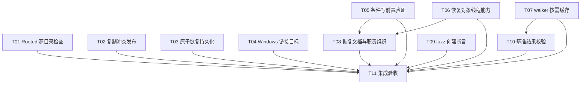

# rs-local-files 本轮评审修复与改进实施计划

> **面向智能体执行者：** 收到实施指令后使用 `executing-plans` 逐项执行，以复选框记录进度。需要并行执行且已有相应授权时，可使用 `subagent-driven-development`。本文件不自动启动实施、提交或推送。

**目标：** 以最小改动落实 LF-01—LF-10，保留原有权限边界，证明修复与改进有效。

**架构：** 保留 facade、Host/Rooted 与 native backend 分层；局部修正复制发布策略、原子恢复、链接解析与前置验证。恢复对象补线程边界，walker 按需缓存名称，补强恢复文档、fuzz 与 Criterion。

**技术栈：** Rust 1.94、edition 2024、qubit-io、qubit-budget、digest/sha2 0.11、现有 libc/windows-sys、tempfile、Criterion、cargo-fuzz；不升级依赖。

**设计依据：** [设计文档](design-20261026T094243622Z-a712afcd.md)。

**工作位置：** `/data/working/qubit/rust-common/rs-local-files`，当前 Paseo workspace。用户指定两份文档保存于 doc，本计划不使用技能默认的临时方案目录。

## 1. 采纳范围与全局要求

- 用户未限定本轮范围，纳入 LF-01—LF-10 全部意见；用户明确搁置或拒绝：无。与其他历史方案的编号不合并。
- LF-01—LF-04 为静态确认的问题；LF-05—LF-07 为设计/API/性能改进，LF-08—LF-10 为文档和验证设施改进。LF-04 原生表现、LF-07 性能收益必须取得实施证据后再宣称验证完成。
- 已撤回的“多文件树复制同步失败误报 Published”不纳入；其他未进入最终报告的候选不扩大进入计划。
- 持续使用当前 Paseo workspace，不创建或打开新 Paseo workspace。仅修改与本轮直接相关内容；不顺带重构、格式化或清理。
- 保持公共签名、默认 feature、MSRV 1.94、edition 2024 和依赖版本。LF-05 提前报错及 LF-04 目标拼写变化按设计记录迁移，不另建 API。
- 实施前读取当时适用的项目约定及 Rust、Rustdoc、测试和 bug-fix 按需规则；操作 Git 或修改 Shell 时才读取对应规则。保留全部用户工作树修改。
- 后续实施按实施命令授权执行；阶段性可审查成果不要求 Git commit。若当时明确授权提交，则按授权和 Git 规则操作，不从当前方案阶段的边界推导未来禁令。
- 当前方案生成阶段到两份文档交付结束；本计划下列动作均尚未执行，属于未来实施，不作为当前工作结果。

## 2. 条目与任务映射

| 评审项 | 实施任务 | 完成证据 |
| --- | --- | --- |
| LF-01 | T01 | 目标/祖先链接拒绝，危险子目标未创建，合法链接成功 |
| LF-02 | T02 | 两竞争窗口的 Fail/Skip 保留 sentinel，Overwrite 正常，清理失败不吞 |
| LF-03 | T03 | 三种 durability 恢复矩阵、实际同步次数、typed state 与磁盘状态 |
| LF-04 | T04 | 原始 reparse buffer 测试和 Windows 原生 referent 结果 |
| LF-05 | T05 | Windows open 即 RequirementNotMet，无父目录/候选副作用 |
| LF-06 | T06 | trait 断言、通用错误转换、跨线程恢复读取与 Drop 行为 |
| LF-07 | T07 | 无缓存状态证明、预算和重开回归、宽目录分配量对比 |
| LF-08 | T08 | 可执行恢复 Rustdoc，局部模块拆分不改状态算法 |
| LF-09 | T09 | 创建失败模型测试拒绝，文件/目录生命周期主体执行 |
| LF-10 | T10 | 每样本验证类别/统计，正确成功与限制 benchmark smoke |
| 全部 | T11 | 平台矩阵、门禁、下游与逐项结果汇总 |

## 3. 调度图

表中路径相对目标仓库。A 批次写入集合互不相交，可并行编辑；B1/B2 在各自前置成果可审查后可并行。这里只描述调度条件，不要求使用额外智能体或 checkout。工作树中可编译、可审查的增量即可解锁，不强制先提交。

所有主仓 Cargo 命令属于资源组 `cargo-main`，共用 target 时重型命令串行；fuzz 为 `cargo-fuzz`，下游为 `cargo-downstream`，重型集成检查由 T11 统一调度。focused 回归可由所属任务运行，全量测试、Clippy、严格 Rustdoc、完整文档消费者及 fuzz smoke 归 T11，避免各叶子重复执行。

| 任务/批次 | 前置任务 | 最小解锁产物 | 写入集合 | 本地验证 | 集成验证归属 | 审查时机 |
| --- | --- | --- | --- | --- | --- | --- |
| T01/A | 无 | 源目录检查和目标根保留 | `src/rooted/copy/rooted_copy_backend.rs`；新 `tests/rooted_copy_containment_tests.rs` | `cargo test --test rooted_copy_containment_tests` | T11 | 立即 |
| T02/A | 无 | 冲突策略贯穿 writer open/commit | `src/rooted/copy/file.rs`；新 `tests/rooted_copy_conflict_race_tests.rs` | `cargo test --features test-support --test rooted_copy_conflict_race_tests` | T11 | 立即 |
| T03/A | 无 | 恢复 bool 与 durability 矩阵 | `src/local/internal/atomic_install_recovery.rs`；`src/local/internal/atomic_file_install.rs`；`src/local/internal/rooted_atomic_install.rs`；`src/local/local_atomic_writer.rs`；`src/local/local_root_atomic_writer.rs`；`tests/local_file_writer_failure_tests.rs` | 私有 recovery 过滤测试、writer failure target | T11 | 立即 |
| T04/A | 无 | SubstituteName/Flags 正确解析 | `src/local/internal/windows_rooted/symlink.rs`；`tests/rooted_windows_symlink_tests.rs` | Windows parser 过滤测试和原生 target | T11 | 立即 |
| T05/A | 无 | open 前保证验证 | `src/local_file_system/conditional.rs`；`tests/conditional_fault_tests.rs` | Windows Required 过滤回归 | T11 | 立即 |
| T06/A | 无 | 恢复 trait Send/Sync | `src/local/internal/conditional/entry.rs`；新 `tests/conditional_thread_contract_tests.rs` | `cargo test --features digest --test conditional_thread_contract_tests` | T11 | 立即 |
| T07/A | 无 | 按需 seen 与宽目录基准 | `src/walk/local_directory_walker.rs`；`src/walk/internal/walk_frame.rs`；`src/walk/internal/rooted_walk_frame.rs`；`tests/local_directory_walker_policy_tests.rs`；`benches/local_files.rs` | walker policy target、私有 cache 测试和宽目录测量 | T11 | 立即 |
| T08/B1 | T05、T06 | 最终条件写与恢复契约 | `src/error/local_conditional_commit_error.rs`；`src/outcome/local_conditional_write_outcome.rs`；`src/local/internal/conditional/backend.rs`；`src/local/internal/conditional/windows.rs`；`src/local/internal/conditional/windows/namespace.rs`；新增三个 Windows 职责文件；四份现行指南/设计 | 恢复状态测试、示例编译 | T11 | 立即 |
| T09/A | 无 | fuzz 不再吞创建失败 | `fuzz/fuzz_targets/support.rs` | `cargo test --manifest-path fuzz/Cargo.toml --test lifecycle_model_tests` | T11 | 批量 |
| T10/B2 | T07 | 同文件中新增 walker 基准已稳定 | `benches/local_files.rs` | 两类 copy benchmark smoke | T11 | 批量 |
| T11/C | T01—T10 | 所有局部增量及证据 | 本设计/计划中的状态记录；仅前述已列文件的必要回修 | 统一集成验收 | T11 | 立即 |

T08 的四份文档为 `doc/user_guide.md`、`doc/user_guide.zh_CN.md`、`doc/local_file_system_design.md`、`doc/local_file_system_design.zh_CN.md`。三个新增职责文件见 T08。T10 在 T07 后实施，复用最终 benchmark 布局并验证新增 workload 的每样本规则；不并发写同一个 bench 文件。

## 4. 任务拓扑依赖图



## 5. 实施前检查

- [ ] 读取 `git status --short`、当前 HEAD 与任务涉及文件的 diff，确认设计之后的修改；不 reset/restore 用户内容。确认当前仓库与当前 Paseo workspace，读取实际存在的适用 AGENTS.md。
- [ ] 阅读设计第 2 节全部条目及本计划写入集合，读取直接相关的按需规则。当前阶段未运行实现验证，执行者不能把本文命令当历史通过记录。
- [ ] 检查本机 Rust 1.94、可用平台、Windows 链接权限及 cargo-fuzz 工具；记录环境缺口，继续不依赖缺口的任务。不要把交叉编译或零个测试计成原生行为通过。
- [ ] 首先验证各问题的确定性回归。若实现基线已修复该问题，则保留证据并调整最小增量，不重复修改或删改已有正确实现。

## 6. 任务步骤

### T01：阻止 Rooted 复制将输出重新纳入源遍历

**文件与接口：** 修改 `src/rooted/copy/rooted_copy_backend.rs`；新增 `tests/rooted_copy_containment_tests.rs`。在 `RootedCopyBackend` 加 `destination_root: Path`。新增私有 `validate_source_directory(source: &Path, destination: &Path, destination_root: &Path, active_sources: &[Path], statistics: Statistics) -> Result<(), Error>`；统一保存现有错误上下文。

- [ ] 新建三个拒绝测试：`test_rooted_copy_rejects_link_to_destination_root`、`test_rooted_copy_rejects_link_to_destination_ancestor`、`test_rooted_copy_preserves_ancestor_cycle_rejection`。另加合法兄弟链接成功测试。只有链接的最小树避免枚举顺序差异，设有限 entries/depth 防旧实现失控，断言具体错误原因及危险子目录不存在。
- [ ] 运行 `cargo test --test rooted_copy_containment_tests`；旧实现的目标链接用例应因未及时拒绝或额外产物而失败，不能把护栏 ResourceLimit 当预期失败原因。Windows 无链接权限单独记录，Unix 主体必须实际执行。
- [ ] 实现以下判定，并将所有 child directory 的检查移动到 `prepare_directory` 之前；普通 ancestor 检查也先于危险层创建：

```text
if destination_root.as_path().starts_with(source.as_path()):
    return structured InspectSource / InvalidInput containment error
if active_sources contains source:
    return existing ancestor-cycle error
otherwise prepare destination, acquire permit, open reader, push frame
```

- [ ] 重跑目标，再运行 `cargo test --test rooted_copy_functional_coverage_tests --test rooted_fault_and_policy_tests`。确认无危险层目录，之前成功的副作用统计仍保留，合法跟随无回归。交付 T11。

### T02：Rooted Fail/Skip 的两段竞争窗口

**文件与接口：** 修改 `src/rooted/copy/file.rs`；新增 `tests/rooted_copy_conflict_race_tests.rs`。不改变 `copy_file` 的外部签名；使用已有 LocalAtomicWriteOptions::with_create_new 和 test-support selector。

- [ ] 增加 `rooted-copy-race-before-writer-open` 与 `rooted-copy-race-before-writer-commit` 一次性 selector。它们只在 test-support 下、所属测试线程生效，通过保留的 Root 创建 sentinel。测试覆盖两个窗口 × Fail/Skip/Overwrite；断言 sentinel 字节、typed state、skipped/files/bytes/overwritten、无遗留 staging。补不同类型冲突和清理失败不转 Skip 的分支。
- [ ] 运行 `cargo test --features test-support --test rooted_copy_conflict_race_tests`，确认旧实现能确定性覆盖 before-open 竞争者，从而回归失败。
- [ ] 在 writer options 构造处实现：

```text
writer_options = LocalAtomicWriteOptions::new().with_durability(durability)
if options.conflict_policy() != Overwrite:
    writer_options = writer_options.with_create_new()
```

对 open/commit 的冲突分别处理，只有证明未发布且无未处理清理错误，按 `decide_copy_destination` 允许 Skip 时才计 skipped。保留其他错误及此前删除产生的 partial 标记；不添加竞争删除重试。

- [ ] 重跑该 target 和 `cargo test --features test-support --test rooted_copy_destination_state_tests --test rooted_copy_permission_publication_tests`。检查 Overwrite、type-conflict 和预算不退还行为。交付 T11。

### T03：普通原子安装恢复遵循 durability

**文件与接口：** 修改调度表列出的六个现有文件，不改公共签名。内部签名调整为 `recover_atomic_install_error<S>(context, staged_file, durability: LocalDurabilityRequirement, cleanup_staging, disarm_indeterminate_staging, sync_parent) -> Result<bool, LocalAtomicWriteError>`；各参数原有回调约束保持。

- [ ] 在 helper 文件内新增必要的私有状态测试，观察 cleanup/sync 调用次数和错误归属。用设计第 6 节矩阵断言 NotRequired 不同步、Preferred 可降级、Required 成功返回 true，清理持续失败或身份不确定仍报错。
- [ ] 为 Host/Rooted 的安装 unlink/recovery 注入增加“恢复最终成功且 sync 成功”组合；扩展 `tests/local_file_writer_failure_tests.rs`，保留现有目的内容与 staging 断言。运行 `cargo test --all-features --lib atomic_install_recovery` 和 `cargo test --features test-support --test local_file_writer_failure_tests`，记录旧实现的预期失败。
- [ ] helper 的成功分支执行 `NotRequired => Ok(false)`、`Preferred => Ok(sync_parent(...).is_ok())`、`Required => sync_parent(...).map(|()| true)`；Required 的错误仍在 SyncParent 且目标已发布。未恢复成功分支保留主错误与次要错误；NotRequired 全分支禁止 sync。
- [ ] 两 writer 传入自身 durability 并直接返回 bool，移除固定 false 映射；保留最终 `file_durable && parent_durable`。重跑上述 focused 命令。Linux 实际 fallback 与私有矩阵分别记录；其他平台不能命中的 native fallback 不虚报覆盖。

### T04：Windows reparse record 采用真实目标

**文件与接口：** 修改 `src/local/internal/windows_rooted/symlink.rs` 及 `tests/rooted_windows_symlink_tests.rs`。保留 `parse_symbolic_link_target` 私有返回类型；不新增公共 read-link 类型。

- [ ] 在原 parser 私有测试中手工构造两个不同名字的 buffer，分别设实际目标 actual.txt、显示目标 display.txt，加入空 PrintName、逆序 offset、相对/绝对 Flags、截断/非法范围与前缀用例。测试不得只经过现有 builder round-trip。
- [ ] Windows 运行 `cargo test --lib symbolic_link_reparse`，旧实现应在不一致名称用例失败。扩展原生 target，使用 Win32 设置原始 reparse 数据，断言 reader 和复制后链接读取 actual 内容；记录链接权限与执行计数。
- [ ] 读取 Flags 和 SubstituteName，按绝对性归一化；未知或无法解释的 record 显式报错，禁止回退 PrintName。保留原长度/偏移校验；verbatim 断言改为实际语义等价，不扩大 UNC/device namespace 支持。
- [ ] Windows 重跑 parser 过滤和 `cargo test --test rooted_windows_symlink_tests`，并检查诊断 root rename/replacement 测试仍使用保留句柄。无 Windows 执行条件时标记原生未验证，交 T11 平台补齐。

### T05：无副作用地提前拒绝静态 Required

**文件与接口：** 修改 `src/local_file_system/conditional.rs` 与 `tests/conditional_fault_tests.rs`，复用已有 `validate_write_options(&LocalWriteOptions, LocalFileSystemCapabilities, LocalFileOperation) -> LocalResult<()>`，不修改其签名。

- [ ] 将旧 Windows `required_parent_sync_unavailability_fails_before_publication` 公共测试更新为 open 失败；增加 Host/Rooted × 目标已有/缺失父目录的回归，期望 RequirementNotMet、OpenWriter、正确 path、原内容不变、无新父目录和候选容器。
- [ ] Windows 运行 `cargo test --features digest,test-support --test conditional_fault_tests required_parent_sync`，旧代码应因 open 成功或产生资源失败。
- [ ] 在原有静态组合检查之后、resolver 之前调用 validate_write_options，给错误保留原请求路径和无 I/O 当前目录信息。不把 Rooted Content、Host Content+UseStaging 等其他平台限制顺手改变成新行为。
- [ ] 重跑该过滤测试，并执行 `cargo test --features digest,test-support --test conditional_writer_tests --test conditional_fault_tests`。确认 Preferred、NotRequired、内部防御性同步失败仍符合现有契约。文档变化交 T08。

### T06：恢复对象可跨线程转移

**文件与接口：** 修改 `src/local/internal/conditional/entry.rs`，新增 `tests/conditional_thread_contract_tests.rs`，新 target 使用 `#![cfg(feature = "digest")]`。

- [ ] 添加以下编译契约，使用公共导入及现有 sha2，不新增依赖；另用函数接受实际失败并转换为 `Box<dyn std::error::Error + Send + Sync>`：

```rust
fn assert_send_sync<T: Send + Sync>() {}

#[test]
fn test_conditional_recovery_types_are_send_sync() {
    assert_send_sync::<qubit_local_files::recovery::LocalRecoveryFile>();
    assert_send_sync::<qubit_local_files::error::LocalConditionalCommitError>();
    assert_send_sync::<qubit_local_files::outcome::LocalConditionalWriteOutcome<sha2::Sha256>>();
}
```

- [ ] 运行 `cargo test --features digest --test conditional_thread_contract_tests`，旧 trait object 应触发 Send/Sync 编译错误，保存失败依据。
- [ ] 将内部 trait 定义改为 `pub(crate) trait RecoveryAccess: Debug + Send + Sync`，保持 `Box<dyn RecoveryAccess>`，由 Unix/Windows/fake 实现自然验证；禁止 unsafe impl 或给 Namespace 强加 Sync。
- [ ] 新增实际失败恢复跨线程用例：在受支持平台制造确定冲突，将结果经 thread::spawn 返回，读取 candidate，转移恢复文件并确认 Drop 不删除。Windows 使用支持的 Absent 冲突，不用不支持的 Rooted Content。重跑 target，交 T08/T11。

### T07：walker 按需名称缓存与性能证据

**文件与接口：** 修改 `src/walk/local_directory_walker.rs`、两个 frame 文件、`tests/local_directory_walker_policy_tests.rs`、`benches/local_files.rs`。新增私有 `needs_seen_names(options: &LocalListOptions) -> bool`，frame 的 seen 改为 Option；不增加公共选项。

- [ ] 在 walker 私有测试验证构造后 seen=None/Some，公开 policy target 验证 Host/Rooted 的稳定目录输出、显式零/有限 seen-name 预算、Fail/Continue、有限句柄 Reopen 无重复及 deadline；预算相关断言沿用现有可观察分类。
- [ ] 判定公式固定为：

```text
explicit_name_budget = options.max_seen_name_bytes().is_some()
can_descend = options.recursive() && (max_depth is None || max_depth > 1)
can_reopen = can_descend && max_open_directories is Some && reopen_policy == Reopen
needs_seen_names = explicit_name_budget || can_reopen
```

先写失败的缓存状态断言并运行 `cargo test --lib walk`；再实现全部 frame 构造点和 Host/Rooted next 路径，不能漏掉 reopened/descendant frame。无集合时直接接受 reader 返回；有集合时保持原名称抑重与预算 admission 顺序。

- [ ] 运行 `cargo test --test local_directory_walker_policy_tests --test local_directory_walker_tests` 及启用 test-support 的同 target。验证无缓存路径仍检查期限、身份和资源，不对累计名称预算退款。
- [ ] 在现有 bench 文件新增 `walk_name_cache` 组，固定 Host/Rooted、100/10,000 条目及名字长度，构造在 setup 区，每样本消费全部结果并核对条数。保留可重开场景作对照，不把目录修改视为快照承诺。
- [ ] 同机器同工具链用分配分析器或独立进程测量分配字节/峰值及 Criterion 时间，记录基线与改后。禁止为了测量更改库的全局 allocator。私有状态必须证明默认宽目录不再逐名称持有；无测量证据不得宣称耗时加速。T10 接手最终 bench 文件，双语契约交 T08/T11。

### T08：补全恢复 Rustdoc 与最小职责拆分

**前置：** T05 的错误阶段和 T06 的线程能力稳定；关于 T07 的并发枚举说明在 T11 核对其最终行为，不占用 walker 源码写入集合。

**修改：** 调度表列出的公开 error/outcome、backend.rs、windows.rs、windows/namespace.rs，以及四份双语指南/规范设计。新增：

- `src/local/internal/conditional/windows/native_receipt_error.rs`：NativeReceiptError 及其 Display/Error/inherent impl。
- `src/local/internal/conditional/windows/private_entry_guard.rs`：PrivateEntryGuard 的身份、armed/disarmed 和 Drop 生命周期。
- `src/local/internal/conditional/windows/private_entry_setup_error.rs`：保留主失败与清理失败的组合错误。

- [ ] 给公开错误补英文 `# Examples`，通过公共 API 构造已知冲突，检查 publication/reason/stage，读取并转移 candidate，转移后读取、Drop 后确认文件仍在，最后只清理示例独占目录。给 error/outcome 字段写语义说明，不承诺自动删除恢复文件或不确定状态安全重试。
- [ ] 按三份职责文件搬出对应声明和 impl，原文件加职责模块注释；仅新增必要的窄访问器/父模块可见性，namespace 内紧密关联类型不机械拆分。补权限、身份、receipt 判定和 backend checkpoints 说明，不改变状态算法。
- [ ] 更新双语指南/规范设计相关段落：Windows Required 的 open 阶段失败、恢复对象线程能力、walker 无缓存与重开去重语义；README 无需为凑文档维度修改。不改历史方案、不覆盖本轮两份文件。
- [ ] 运行 `cargo test --features digest,test-support --lib conditional_` 及 `cargo test --features digest --doc local_conditional_commit_error`。Windows 编译并执行现有 conditional native/cleanup 测试，确认移动前后错误 source 链、Drop/cleanup 和 retained identity 相同。全量双语消费者验证由 T11 负责。

### T09：生命周期 fuzz 必须观察创建失败

**文件与接口：** 仅修改 `fuzz/fuzz_targets/support.rs`，测试进入现有 `lifecycle_model_tests`，不新增 fuzz bin。局部新增 `require_created<T>(result: LocalResult<T>, kind: &str) -> T`。

- [ ] 在 support 的私有测试中对 Unsupported、InvalidPath 输入断言 helper panic，成功输入返回原值。创建阶段不得继承 initial scratch root 的静默跳过约定。
- [ ] 用明确实现替换两个 `.ok().map(...)` 分支：

```rust
fn require_created<T>(result: LocalResult<T>, kind: &str) -> T {
    match result {
        Ok(resource) => resource,
        Err(error) => panic!("prepared lifecycle fixture could not create {kind}: {error}"),
    }
}
```

创建成功后才更新模型预算、Owned/current；保留写 payload 和后续状态断言。初始 root/filesystem 环境准备跳过逻辑不变。

- [ ] 添加 Host/Rooted 固定序列测试，以 `[0, 0, 11, 0, 4, 0, 5, 0]` 和 `[0, 1, 11, 0, 4, 0, 5, 0]` 分别建立文件/目录、遍历、显式 cleanup 并 Drop。当前 opcode 0 创建、11 遍历、4 清理、5 Drop；在测试见证中核对创建和清理各完成一次，资源进入 Released 且产物消失，不以 run 返回且无 panic 代替主体执行证明。
- [ ] 运行 `cargo test --manifest-path fuzz/Cargo.toml --test lifecycle_model_tests`。记录新增测试实际数量与错误拒绝结果。完整 fuzz smoke 交 T11；本任务不执行长期 fuzz。

### T10：每个基准样本检查真实结果

**前置与文件：** T07 的 `benches/local_files.rs` 最终布局稳定；仅修改同一文件，保留其新增 walker 组。

- [ ] 将 copy_budget_width 闭包的丢弃结果替换成 `assert_copy_limit(result, LocalResourceKind::Entry)`。copy_tree_depth 的 limited 分支用 Depth，success 分支 expect 成功并 `assert_eq!(1, outcome.stats().files())`，black_box 有效结果/统计。
- [ ] 保留 fixture 准备与清理在计时区外，廉价分类断言在计时闭包内；原 payload 预检继续存在，不添加每样本全文件重读。检查新增 walk_name_cache 每样本也消费全部结果并验证条数。
- [ ] 执行 `cargo bench --bench local_files -- copy_budget_width --test`、`cargo bench --bench local_files -- copy_tree_depth --test`、`cargo bench --bench local_files -- walk_name_cache --test`。预期全部 workload 完成，限制样本验证正确资源种类，success 样本实际成功，不能把编译成功作为通过。
- [ ] 检查闭包不再有未分类的 copy Result 丢弃；将任何环境错误视为无效测量并停止，不作为吞吐样本。交 T11，不从历史吞错样本计算改进比。

### T11：统一集成、平台验证和结果记录

**前置：** T01—T10 可审查增量和 focused 证据齐全。职责是统一验收与必要相关回修，不新建其他改进项目。主仓、独立 fuzz、下游命令分别从对应仓库执行。

- [ ] 检查最终 diff：只有本计划列出的相关路径变化，没有依赖升级、公共签名破坏、无关格式化或用户改动丢失。核对 T08 双语描述与 T07 实现完全一致；检查十项任务都有实现或明确未验证记录。
- [ ] 阅读项目门禁脚本确认作用范围，按项目规则执行必要的格式/风格流程；若通用 alignment 会修改无关文件，采用范围可控的等效方式并记录。准备使用可能清理产物的脚本前，确认仅涉及可安全重建的产物，不能删除用户数据。
- [ ] 主仓串行运行下列命令，预期退出 0；测试输出必须包含真实运行的相关用例：

```bash
cargo test --locked
cargo test --locked --all-features
cargo clippy --locked --all-targets --all-features -- -D warnings
cargo test --locked --all-features --doc
cargo test --locked --features digest --test documentation_consumer_tests
```

严格 Rustdoc 用受控环境参数运行 `RUSTDOCFLAGS='-D warnings' cargo doc --locked --all-features --no-deps`；执行项目要求的 style-check。若使用完整 ci-check 覆盖上述集合，可依据其真实日志消除重复，不因脚本名字推定已经覆盖。

- [ ] 独立 fuzz 运行 `cargo check --locked --manifest-path fuzz/Cargo.toml --all-targets` 和 `cargo test --locked --manifest-path fuzz/Cargo.toml --test lifecycle_model_tests`。在配置了 cargo-fuzz 的环境，从 fuzz 工作目录对 lifecycle/rooted_lifecycle 各执行 10 秒 smoke，artifact/corpus 写入本轮专属可丢弃目录，保留失败输入；不静默改写仓库 corpus 或锁文件。
- [ ] Linux/macOS/Windows 各运行适用的回归与 all-features。Windows 必须有 LF-04 原生不一致名称链接、LF-05 open 前拒绝、LF-06 跨线程测试；记录符号链接权限、测试数量和任何 skip。目标不支持的故障协议、交叉编译结果和原生运行结果分别记录。
- [ ] 核对下游实际使用目标源码，优先利用现有 coordinated candidate fixture 和路径身份检查；先检查 prepare/check 脚本及锁文件策略，不能为通过测试改写真实下游 manifest/lock。对 candidate 图运行 rs-fs-local 的复制/遍历/错误恢复及全特性测试、rs-mime 临时 staging 和全特性测试。rs-magika 只在其实际可用图中做间接兼容性验证，不虚称直接调用 conditional。缺依赖/网络/平台则明确标未验证。
- [ ] 对 LF-07 记录同机器宽目录分配量和时间，证据至少包括条目数、平台、工具链、options、缓存状态、样本结果有效性与改前/改后数据；性能工具不可用则只报告结构性内存改进，不宣称实测加速。
- [ ] 在本设计/计划的结果区更新逐项状态、命令/退出码、平台、失败或跳过原因和下游来源身份。只有必须项通过且没有遗留缺陷时才报告全部完成；存在平台缺口时逐项报告，不把“计划任务已勾选”替代验证结果。Git 提交/推送仅按实施阶段实际授权办理。

## 7. 交付自查清单

- [ ] LF-01—LF-10 与 T01—T10 一一对应，所有局部任务进入 T11；调度表、拓扑图、任务列表 ID 相同。
- [ ] 每个修复有可复现的旧行为失败证据和改后通过证据；设计改进不包装为已发生的数据故障。
- [ ] LF-02 没有吞清理错误；LF-03 没有丢失 Published；LF-04 没有丢失绝对性；LF-07 没有放宽显式预算；LF-08 没有改变 guard Drop。
- [ ] 双语指南/规范设计语义一致，Rustdoc 示例以公共路径运行且清理自己独占的产物。
- [ ] 所有 skip、未运行和缺平台均明确记录；没有用零个测试、交叉编译或历史 CI 替代本次验证。
- [ ] 没有将当前只写方案阶段边界写成未来“不改代码、不测试、不提交”的验收要求，也没有从本计划推断额外操作授权。

## 8. 当前状态

方案生成完成；T01—T11 均待未来实施命令启动。本阶段未执行代码修改、回归测试、构建、平台验证、性能测量或 Git 状态变更操作。用户明确搁置/拒绝仍为无。
