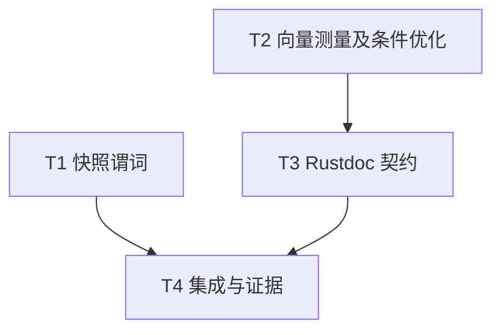

# rs-local-files 本轮评审修复实施计划

> **面向智能体执行者：** 使用 executing-plans 按任务实施并记录检查点；本文件是下一阶段执行说明，当前仅生成文档。

**目标：** 完成 RLF-001、RLF-002、RLF-003 的局部修复、测量与契约补齐。

**架构：** 保持现有 Host／Rooted 和公共 API。收紧快照身份谓词；向量性能先测后改；补齐对应 Rustdoc。

**技术栈：** Rust 1.94.0、edition 2024、Criterion、现有 qubit-io 与项目 CI 工具。

**文档位置：** 按用户指定路径保存在目标项目 doc；不另建临时方案工作区。

**设计依据：** [设计文档](design-20261104T160818789Z-8cf0753d.md)。

## 采纳范围与全局要求

- 纳入 RLF-001：比较函数显式拒绝缺失身份并补回归；不宣称公开快照存在已验证缺陷。
- 纳入 RLF-002：建立基准；收益未经验证，按设计门槛决定是否保留安全的单缓冲快路径。
- 纳入 RLF-003：补齐本轮列出的 Rustdoc；不扩张为全仓风格整改。
- 无明确搁置或拒绝条目。无新增生产依赖、公共 API 破坏或下游迁移。
- 继续使用用户当前 Paseo workspace，不创建或打开新的 Paseo workspace。
- 未来实施权限以实施命令为准；允许必要的源码、测试及 CI 错误修复，包括已有基线问题，不降低验证或覆盖率门槛。不要把方案生成阶段的只写文档边界套用到实施阶段。
- 实施开始读取适用 AGENTS.md、技能和最新风格规范，保留用户改动。若需要 Git linked worktree，仍归属当前 Paseo workspace，不创建新的 Paseo workspace。

## 调度图

| 任务 | 前置任务 | 最小解锁产物 | 写入集合（相对 rs-local-files） | 本地验证 | 集成验证归属 | 审查时机 |
| --- | --- | --- | --- | --- | --- | --- |
| T1 快照谓词 | 无 | 原有内部签名即可 | src/observation/local_file_snapshot.rs；src/tests/lf3_read_tests.rs | cargo test --locked --all-features --lib lf3_read_ | T4 | 立即审查 |
| T2 向量测量及条件优化 | 无 | 原有公共流接口即可 | benches/local_files.rs；条件修改 src/local_file_reader.rs、src/writer/local_file_writer.rs、src/temp/local_temp_file.rs、src/local/local_atomic_writer.rs、src/local/local_root_atomic_writer.rs、src/tests/vectored_tests.rs；doc/review-20261104-vectored-evidence.md | cargo bench --locked --bench local_files -- vectored_io；cargo test --locked --all-features --lib vectored | T4 | 立即审查测量结论及候选分支 |
| T3 Rustdoc 契约 | T2 | 向量接口最终分支和分配行为确定 | src/vectored.rs；src/observation/query.rs；src/local_file_reader.rs | cargo test --locked --all-features --doc local_file_reader | T4 | 批量审查 |
| T4 集成与证据 | T1、T3 | 局部修复和基准结论齐备 | 最终必要修复及证据文档；必要时相关双语文档 | 项目 CI、跨平台及下游回归 | T4 独占 | 立即审查 |

T1 与 T2 为同一可并行批次，写入集合不重叠；T3 等待 T2 释放 reader 文件。此图表示依赖关系，不额外授权启动子智能体。重型 Cargo 命令共用 target 资源时串行，避免锁竞争和基准污染；全量门禁仅由 T4 执行。

## 任务拓扑依赖图



## T1：快照比较及确定性回归

输出签名保持 `observations_match(before: &LocalFileObservation, after: &LocalFileObservation, count: u64) -> bool`。

- [ ] 在 `src/tests/lf3_read_tests.rs` 用临时文件、LocalFileReader::from_file 和 Required observation 取得有效 baseline，派生双方 identity 为 None、仅一方 None 的输入。派生构造使用已有内部接口：

```rust
let missing = crate::observation::LocalFileObservation::from_parts(
    before.metadata().clone(), None, before.native_details().cloned(),
);
assert!(!crate::observation::snapshot::observations_match(
    &missing, &missing, before.metadata().len(),
));
```

- [ ] 运行 `cargo test --locked --all-features --lib lf3_read_`，保存新增缺失身份断言在旧实现失败的输出；区分编译失败与预期断言失败。
- [ ] 在 `observations_match` 首部改为以下身份 guard，后面的长度与 native_match 比较保持原样：

```rust
match (before.identity(), after.identity()) {
    (Some(left), Some(right)) if left == right => {}
    _ => return false,
}
```

- [ ] 加入正常相等、不同身份、缺失 native details、长度与 count 不同、修改时间和状态变化时间不同的案例。Unix 使用 `LocalUnixFileDetails::from_parts`／`LocalNativeFileDetails::from_unix`，Windows 使用 `LocalWindowsFileDetails::new`／`LocalNativeFileDetails::from_windows`。复用 `LocalFileObservation::from_parts`，不用新增公共入口；按平台 cfg 保证编译。
- [ ] 重跑 focused 命令，所有 lf3_read_ 用例通过；审查未修改公开快照入口或错误分类。

## T2：建立证据并决定向量优化

输入为现有固有向量接口及 Input／Output trait；输出为可复现基准、明确决策及可选的内部快路径，无新增公共接口。

- [ ] 在 `benches/local_files.rs` 注册 `vectored_io` 组。buffer 数用 `[0, 1, 2, 8, 16, 64]`，段大小用 `[64, 4096]`。对 reader 比较 IoSliceMut 与 `Input::read_vectored`，对直接模式 writer 比较 IoSlice 与 `Output::write_vectored`；准备和恢复偏移在计时外。先在非计时阶段验证返回数据和进度一致。
- [ ] 运行 `cargo bench --locked --bench local_files -- vectored_io --save-baseline rlf002-before`，保存环境和输出到 `doc/review-20261104-vectored-evidence.md`。补独立分配采样，仅计适配调用；数据不能混入 fixture、打开和 cleanup。
- [ ] 依照设计的收益门槛判断是否值得尝试单缓冲快路径。没有可靠证据则保留生产实现，在证据文档说明，直接交付 T3；不编造性能百分比。
- [ ] 值得尝试时，先在 `src/tests/vectored_tests.rs` 覆盖一个 buffer、全空、多 buffer、短读写和 writer 非法状态。沿用现有公开／内部 writer fixture，不改变提交协议。单缓冲转换示意为：

```rust
// 放在原有状态校验和全空处理之后；self 为原有 trait 转发接收者。
if buffers.len() == 1 {
    let mut one = [&mut buffers[0][..]];
    return qubit_io::Input::read_vectored(self, &mut one);
}
```

writer 使用不可变单元素 slice 数组，调用原来的 Output 转发路径；不得递归调用固有方法或绕过 writer 原有失败态检查。对表中五个消费转换的文件逐一核对。大于一个 buffer 继续原 Vec 路径，不做栈容量框架、不引入 unsafe。
- [ ] 运行 `cargo test --locked --all-features --lib vectored` 及 `cargo test --locked --all-features --test local_file_reader_tests --test local_file_writer_tests`。保留已有 Windows fallback 进度和 Interrupted 测试。
- [ ] 在同机同配置重复运行基准两轮，使用 `--baseline rlf002-before` 对照。采用设计中的两轮、95% 区间、至少 5% 收益及无可重复超过 5% 退化门槛。达不到则仅撤销本任务的候选优化，保留基准和测量结论，不丢弃其他改动。

## T3：补齐最终实现的 Rustdoc

- [ ] 给 `src/vectored.rs` 两个 helper 增加英文目的、参数、返回、借用生命周期与分配失败说明；明确复制的是 slice 描述符而非文件内容。
- [ ] 给 `src/observation/query.rs::query_observation` 增加英文参数、返回、错误与平台分支说明，逐一核对 unix.rs、windows.rs 和非 Unix／Windows fallback，不把 Optional 写成忽略所有错误。
- [ ] 给 `src/local_file_reader.rs::read_vectored` 补齐空输入、短读、EOF、有序前缀、Windows 顺序 fallback 的进度优先返回规则和适配分配失败说明。若 T2 保留单缓冲快路径，限定何时分配。
- [ ] 增加使用公共 LocalFileSystem 创建 reader 并检验有序前缀的 Rustdoc 示例，处理返回计数，不断言一次调用填满全部 buffers。
- [ ] 运行 `cargo test --locked --all-features --doc local_file_reader`。审查文案与 T2 最终代码一致，再交给 T4 全量文档门禁。

## T4：集成验证与交付

- [ ] 检查 diff 仅覆盖本轮目标及必要基线修复，逐项对照设计验收；确认 Cargo 本地依赖解析。执行前读取 `.infra/bin/ci-check.sh` 和 bootstrap 实际实现，采用项目配置，不凭 wrapper 推测门禁内容。
- [ ] 按适用仓库规范执行格式整理及风格检查；复查整理后的源文件。运行 `cargo test --locked --no-default-features`、`cargo test --locked --all-features`、`cargo test --locked --no-default-features --doc`、`cargo test --locked --all-features --doc` 和 `RUSTDOCFLAGS='-D warnings' cargo doc --locked --all-features --no-deps`。这些命令是 ci-check 未覆盖时的补充，已由门禁相同配置执行并保存证据的项目无需重复。
- [ ] 运行 `./.infra/bin/ci-check.sh` 并记录退出码；读取项目覆盖率配置，运行相应覆盖率门禁（如该入口未包含则使用 `./.infra/bin/coverage.sh`）。有失败先定位，允许新增／修改必要测试与源码，包括相关已有基线问题，不能删除断言、忽略失败或下调阈值。
- [ ] 在 Linux、macOS、Windows 对应环境执行快照与向量 focused 测试，保存各平台实际运行证据。复用现有 CI 执行方式；远端操作按实施命令授权，不在当前方案阶段触发。缺平台环境时标明缺口，不写成全部通过。
- [ ] 在 `rs-fs-local` 运行 `cargo test --locked --lib`，在 `rs-mime` 运行 `cargo test --locked --lib temp_staging`；先核实 filter 实际执行至少一个目标测试。对 `rs-magika` 运行 `cargo check --locked --all-targets`。依赖解析必须指向本地目标；不能以缓存 registry 包替代。环境或外部资源阻断需记录真实原因，不删除相关检查。
- [ ] 将 RLF-001 回归、RLF-002 保留／不保留优化结论、RLF-003 文档结果和验证命令汇总到证据文档，审查风险。涉及双语既有文档说明时同步修改对应段落，无需重写整篇。
- [ ] 按下一阶段命令执行其明确授权的 Git 收尾动作；本计划本身不推断提交或推送权限。

## 设计覆盖与完成判定

| 必须项 | 任务 | 完成证据 |
| --- | --- | --- |
| 缺失 identity 显式拒绝及边界回归 | T1 | 旧实现失败／新实现通过与平台案例 |
| 基准矩阵、同机对照和条件决策 | T2 | 环境、命令、置信区间、分配采样和结论 |
| 局部 Rustdoc 完整且与最终行为一致 | T3 | 对应 diff、示例及文档检查 |
| API 兼容、下游及完整门禁 | T4 | 本地依赖、平台执行、CI 和覆盖率证据 |

T1～T4 与调度图、拓扑图一致。方案阶段没有执行任何实施验证；实施阶段全部适用门禁通过且证据齐全后才能宣称完成。
