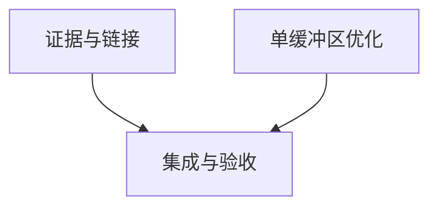

# rs-local-files 评审改进实施计划

> 面向执行者：逐项执行并使用复选框记录证据；可使用 executing-plans 技能。用户已授权直接制定方案，不需要再次设计审批。执行修改须以随后实施命令的授权为准。

**目标：** 完成 RLF-001、RLF-002，并核查已接受的 Windows 待验证事项。
**架构：** 恢复证据索引并检查文档链接；在原 trait 调用之前增加单元素栈分支，保留后端和公开接口。
**技术栈：** Rust 2024、项目固定工具链、qubit-io、现有 Criterion 和 rs-infra 门禁。
**设计：** [配套设计](design-20261108T130819029Z-d8bcd0a4.md)。

## 采纳范围及约束

纳入 RLF-001（已确认 P2）、RLF-002（已确认 P3）及 Windows sealed cleanup/暂存清理/枚举证据核查（待验证，原评审无编号）。没有明确搁置或拒绝条目。核查先于缺陷认定和修复。
继续使用当前 Paseo workspace，不创建或打开新的 Paseo workspace。实施前记录现有 dirty 基线，保留用户变更；不得以覆盖文件或 reset 消除基线问题。
本计划不新增提交或推送授权，按后续实施命令处理。允许修复测试、CI、coverage 暴露的相关基线问题及新增回归，包括必要的源码与测试修改；禁止降低验证门槛。

## 调度图

| 任务 | 前置任务 | 最小解锁产物 | 写入集合 | 本地验证 | 集成验证归属 | 审查时机 |
| --- | --- | --- | --- | --- | --- | --- |
| T1 证据和链接 | 无 | 两个证据索引、链接检查及双语状态说明 | 两个 review 证据文件、六份双语文档、tests/documentation_links_tests.rs；必要时 Windows 测试/workflow | 链接测试及有条件的原生 Windows 精确用例 | T3 | 立即审查证据真实性 |
| T2 单缓冲区优化 | 无 | 两个入口及回归证据 | src/local_file_reader.rs、src/writer/local_file_writer.rs、tests/io_reader_contract_tests.rs、tests/io_writer_contract_tests.rs、必要的独立分配回归文件 | 两个契约测试及 vectored 基准 | T3 | 批量审查 |
| T3 集成 | T1、T2 | 完整 diff 和门禁记录 | 必要的相关基线修复及覆盖补充，避免覆盖既有变更 | 全项目门禁 | T3 | 立即审查 |

T1、T2 为同一可并行批次，写入集合不相交；不是启动多智能体的要求。Cargo/coverage/benchmark 共用构建资源组，重型命令串行执行。无需接口提交来解锁后续任务，工作树可审查产物即可解锁 T3。

## 任务拓扑依赖图



## T1：恢复可核查证据与链接回归

接口：输入为现存六份文档、Git 历史及可获得的原生日志；输出为两个现有引用目标和准确的平台状态，不输出虚构通过记录。

- [ ] 在目标仓库记录 `git status --short`、当前 HEAD 和相关文件 diff；确认实施基线与方案描述一致，不丢弃用户变更。
- [ ] 定位全部引用：`rg -n 'review-rlf[34].*evidence' README*.md doc`。检查对应历史：`git log --all -- doc/review-rlf3-windows-evidence.md doc/review-rlf4-windows-staging-cleanup-evidence.md`。
- [ ] 新建 `tests/documentation_links_tests.rs`。用标准库扫描指定文档内 `](target)`，记录行号，过滤 URL/纯锚点，移除 fragment 后以来源目录解析；缺失目标收集后统一断言。为有效文件、缺失文件、锚点和 URL 增加小 fixture 测试，防止检查器无效通过。不扫描本次方案文件，避免将工具输出标记当正文链接。
- [ ] 执行 `cargo test --locked --test documentation_links_tests`，确认真实失效引用被报告，保存失败输出。
- [ ] 创建 `doc/review-rlf3-windows-evidence.md` 和 `doc/review-rlf4-windows-staging-cleanup-evidence.md`。分别记录枚举和暂存/清理；内容字段为用例、revision、命令、执行数、结果、日志来源、卷/权限事实和限制。未知字段写“未取得”，历史正文陈述与当前可核验日志分开。
- [ ] 检查 `.github/workflows/ci.yml` 和相关 Windows 用例。原生可运行时，对无默认特性及全部特性执行选中的精确测试，确认非零运行并保存日志。枚举示例目标为 `review_windows_root_enumeration_tests`，暂存为 `windows_rooted_staging_cleanup_tests`；先 `-- --list` 确认精确名称，再用 `-- --exact --nocapture` 执行。sealed cleanup 同样从 `lf3_temp_tests` 等现有测试清单选出真实名称。
- [ ] 若没有原生运行条件，记录缺少的环境和具体命令，保留待验证结论；若失败，先分类环境/测试/实现原因，再最小修复并重跑精确用例，不能把未核验疑点直接改成缺陷。
- [ ] 更新 `README.md`、`README.zh_CN.md`、`doc/user_guide.md`、`doc/user_guide.zh_CN.md`、`doc/local_file_system_design.md`、`doc/local_file_system_design.zh_CN.md` 的证据状态，消除相互矛盾。两个索引中的本地链接也加入测试输入。
- [ ] 重跑链接测试，预期全部通过；人工核对原十处引用和双语陈述。现有 doctest 留给 T3 集中运行。

## T2：单元素栈分支与契约回归

接口：保留 `LocalFileReader::read_vectored(&mut self, &mut [IoSliceMut<'_>]) -> io::Result<usize>` 和 `LocalFileWriter::write_vectored(&mut self, &[IoSlice<'_>]) -> io::Result<usize>`。所有状态/故障语义继续由原 trait 实现承担。

- [ ] 在修改前运行并保存 `cargo bench --locked --bench local_files -- vectored_io` 的单缓冲区分配采样，记录 OS、工具链、feature 和载荷。与修改后必须在相同环境比较。
- [ ] 扩充 reader 契约测试：单元素非空读取、非零偏移、EOF、单空元素及空数组，断言返回数和缓冲区内容；多元素既有测试继续运行。writer 覆盖单元素写入、单空元素、终止后的空/非空请求 BrokenPipe 和累计写入结果。复用现有临时 fixture 和真实公开 API。
- [ ] 若建立自动分配回归，使用独立集成测试二进制、线程局部分配计数器；预先构造 fixture、打开句柄并准备缓冲区，只计调用区间，先确认修改前单缓冲区存在适配分配。不得将全进程并发测试分配作为本调用分配数。至少保留现有 benchmark 前后 ALLOC_SAMPLE 证据。
- [ ] 在 reader 的全空提前返回之后增加：

```rust
if let [buffer] = buffers {
    let mut slices = [&mut buffer[..]];
    return qubit_io::Input::read_vectored(self, &mut slices);
}
```

- [ ] 在 writer 的 Open/failure_state 检查之后、`byte_slices` 之前增加：

```rust
if let [buffer] = buffers {
    let slices = [&buffer[..]];
    return Output::write_vectored(self, &slices);
}
```

- [ ] 保留多元素路径，不更改 `src/vectored.rs` 的通用实现，不直接调用 std 后端。reader Rustdoc 将“每次非空调用分配”调整为“多缓冲区适配分配”；注明单元素描述符在栈上，后端分配不在承诺内。
- [ ] 执行 `cargo test --locked --test io_reader_contract_tests --test io_writer_contract_tests`，并以 `--all-features` 重复；预期内容、状态及空输入契约均通过。
- [ ] 在与基线相同环境运行 vectored 基准，核对单缓冲区适配分配减少、多缓冲区结果不变；吞吐只记录测量值，不要求未经测量的提升百分比。

## T3：集成门禁与交付

- [ ] 汇总 T1/T2 diff，区分用户已有变更、此次修改和必要基线修复；核对没有公开 API、依赖或下游迁移变更。
- [ ] 按项目固定工具执行 `./.infra/bin/align-ci.sh`，审阅其修改，防止将用户无关变更静默纳入结果。
- [ ] 串行执行 `cargo test --locked --no-default-features --no-fail-fast`、`cargo test --locked --all-features --no-fail-fast`，以及两种 feature 的 `cargo test --locked --doc`；预期无失败，不能以零目标测试宣称平台行为通过。
- [ ] 执行 `./.infra/bin/ci-check.sh` 和 `./.infra/bin/coverage.sh`，遵循仓库当前门槛，保留退出码与完整报告；如工具包含已执行检查可复用其结果，避免无意义重复。
- [ ] 发生失败时先确认是否基线已有，允许增补测试及必要源码修复直至门禁满足；禁止放宽阈值、删用例、扩大 ignore 规避问题。修复后重跑受影响检查，记录关联条目。
- [ ] 如环境无法执行某门禁，明确说明未完成项和原因，不宣称完整验证；Windows 无原生证据时仍为待验证，不影响对已完成链接修复和局部优化分别交付结论。
- [ ] 最终报告逐项映射 RLF-001、RLF-002、Windows 核查，给出文件、命令、结果、分配对照和剩余限制。提交/推送遵循实际实施命令授权，不因计划中任务完成自动执行。

## 方案自检记录

RLF-001 对应 T1；RLF-002 对应 T2；Windows 待验证项对应 T1 的证据分支；双语一致性对应 T1；全量验证、覆盖率与必要基线修复对应 T3。调度表、拓扑和任务列表均为 T1/T2/T3。无排除条目，无额外兼容性迁移，无降低门禁安排。此处描述未来执行步骤，不表示本阶段已运行任何实施验证。
