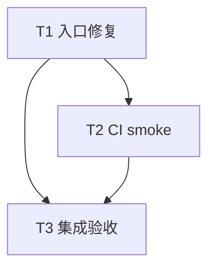

# RLF6-001 条件写入 fuzz 修复实施计划

> **面向智能体执行者：** 使用 executing-plans 逐项实施本计划，复选框跟踪进度。当前交付是方案，不开始执行。

**目标：** 消除条件 fuzz 静默退化，并让随机输入同时探索 Host 与 Rooted。

**架构：** 保留现有 conditional model；在 fuzz 子包默认开启 conditional，并以 required-features 防止错误配置。单入口对同一输入运行两种模式，Linux CI 显式执行有界 smoke。

**技术栈：** Rust 1.94.0、cargo-fuzz 0.13.2、nightly-2026-06-05、libFuzzer、GitHub Actions。

**设计：** [配套设计](design-20261109T103802287Z-4208cd12.md)。使用当前 Paseo workspace，无临时方案目录。

## 采纳范围与约束

- 纳入：RLF6-001 全项（feature gate、条件模型、Rooted 随机探索、显式 smoke）。
- 明确搁置或拒绝：无。
- 持续工作区限制：在当前 Paseo workspace 操作，不创建或打开新的 Paseo workspace。
- 最小改动，不为统一风格或潜在扩展扩大范围；不降低既有验证门槛。
- 允许为验证失败、ci-check.sh 错误或覆盖率不足补测试及必要源码修复，包括已有基线问题。记录实际原因及回归证据，不机械限制为 workflow/文档修改。
- 用户已有锁文件修改和旧文档删除须无损保留。未来提交/推送按实施命令明确授权处理；本计划不要求此时提交。

## 调度图

| 任务 | 前置任务 | 最小解锁产物 | 写入集合 | 本地验证 | 集成验证归属 | 审查时机 |
| --- | --- | --- | --- | --- | --- | --- |
| T1：入口修复 | 无 | 默认可构建、每输入运行两种条件模型的 target | `fuzz/Cargo.toml`、`fuzz/fuzz_targets/conditional_lifecycle.rs`；必要时 conditional 模型测试 | feature 构建矩阵、固定模型回归 | T3 | 立即审查 |
| T2：CI smoke | T1 | 可执行条件 target | `.github/workflows/ci.yml` | workflow/shell 检查 | T3 | 立即审查 |
| T3：集成验收 | T1、T2 | 修复及 CI 命令完整 | 必要的验收修复和证据；按失败实际定位 | 完整 ci-check、实际 smoke | T3 独占全量/coverage/fuzz 资源 | 立即审查 |

任务依赖真实存在，串行执行；无需为了本次小改动派发并行实现任务。资源组为本仓库 Cargo target/fuzz corpus，全量命令串行。



## T1：修复配置与双模式入口

- [ ] 记录完整 HEAD、`git status --short` 和既有 diff，复读设计列出的四处证据；读取实施时适用仓库规则。复核工具版本及锁文件，不丢弃既有改动。
- [ ] 修复前确认 manifest 没有 default conditional / target gate，入口有普通模型回退；运行已有固定模型回归作为行为基线。这是配置错误的直接证据，不制造脆弱的源码字符串测试。

```sh
cargo test --locked --manifest-path fuzz/Cargo.toml --features conditional --test conditional_model_tests
```

- [ ] 在 fuzz manifest 的 `[features]` 增加以下默认配置，并在 `conditional_lifecycle` 的 `[[bin]]` 增加 gate；保留现有 conditional feature 内容。

```toml
[features]
default = ["conditional"]
conditional = ["dep:sha2", "qubit-local-files/digest", "qubit-local-files/test-support"]

[[bin]]
name = "conditional_lifecycle"
path = "fuzz_targets/conditional_lifecycle.rs"
required-features = ["conditional"]
test = false
doc = false
bench = false
```

- [ ] 保留源码头、`#![no_main]` 和共享 support 声明；删除条件模块/入口的 cfg 与普通 lifecycle 回退，主体改为：

```rust
use libfuzzer_sys::fuzz_target;

#[path = "support/conditional_model.rs"]
mod conditional_model;
mod support;

fuzz_target!(|data: &[u8]| {
    conditional_model::run_model(data, false);
    conditional_model::run_model(data, true);
});
```

- [ ] 顺序运行 feature 矩阵。第二条必须因缺少 conditional 明确失败；不能把编译错误以外的工具/网络错误当作预期失败。其余命令须成功。固定回归保留原先两种模式、十组序列和 witness 断言，不能改为只检查返回成功。

```sh
cargo check --locked --manifest-path fuzz/Cargo.toml --bin conditional_lifecycle
cargo check --locked --manifest-path fuzz/Cargo.toml --no-default-features --bin conditional_lifecycle
cargo check --locked --manifest-path fuzz/Cargo.toml --no-default-features --features conditional --bin conditional_lifecycle
cargo test --locked --manifest-path fuzz/Cargo.toml --features conditional --test conditional_model_tests
cargo test --locked --manifest-path fuzz/Cargo.toml --test lifecycle_model_tests
```

接口产物：target 名称及输入字节解释保持不变；每次输入同时调用现有 `run_model(data: &[u8], rooted: bool)`。不引入生产接口。

## T2：CI 明确执行随机 smoke

- [ ] 在 `.github/workflows/ci.yml` Linux 分支既有 conditional 固定模型回归成功之后，增加以下命令。先检查现有 runner 已安装工具的版本；如已满足以下固定版本，复用而不重复安装。显式命令不能被通用 fuzz 步骤有无执行所替代。

```sh
rustup toolchain install nightly-2026-06-05 --profile minimal
cargo install cargo-fuzz --version 0.13.2 --locked
cargo +nightly-2026-06-05 fuzz run conditional_lifecycle --features conditional -- -max_total_time=10 -max_len=4096
```

- [ ] 让命令非零退出直接使 job 失败，不使用 `|| true`、零测试兜底或仅编译替代。记录 libFuzzer 实际执行日志。
- [ ] 记录崩溃输出和 `fuzz/artifacts/conditional_lifecycle` 中的复现路径。复用共享 workflow 已有的 artifact 能力（若其覆盖该路径）；不要向 `uses:` 型复用 job 直接添加 `steps`。若共享流程未归档该目录，应在结果中明确该限制，并在本地保留复现输入；本次不为新增上传能力重构 CI。
- [ ] 检查新增 YAML 缩进与 shell 退出传播；保留原有条件编译、固定回归及 Windows/macOS 矩阵，不修改共享基础设施仓库。

接口产物：Linux 额外验证产生可观察的条件模型随机执行日志；有崩溃时保存对应输入供复现，并明确远端归档的实际可用性。

## T3：集成验证与验收

- [ ] 核对 T1/T2 diff：没有普通模型回退，没有生产 crate 默认 feature 变化，两次模型分别使用 false/true，原始字节直接传入。
- [ ] 在支持两种模式的本地 Linux 环境运行 T2 的 smoke 命令，检查输入执行记录及退出状态；固定回归必须证明 fixture 建立并触发 oracle，不能将 fuzz 运行中的资源不足跳过视为两套模型覆盖成功。
- [ ] 执行 `./.infra/bin/ci-check.sh`，保存完整日志、退出码及生成的覆盖率结果。遵循实施时有效的统一开发规范执行 alignment、风格检查、Clippy、Rustdoc、feature 矩阵等门禁；不更改现有阈值或排除覆盖文件来换取成功。
- [ ] 若测试/CI/覆盖率失败，区分本次引入、既有基线与环境原因。允许修改必要测试及源码修复；行为修复须有先失败后通过的回归。复核受影响范围并重跑失败项及依赖它的门禁，不把基线失败直接豁免。环境阻塞须如实记录，不能宣称验收通过。
- [ ] 依实施命令授权取得实际 CI 执行证据；如未获远端写入授权，交付本地验证证据并明确原生远端步骤未执行，不将配置审查冒充远端 CI 成功。
- [ ] 交付 RLF6-001 的改动位置、feature 矩阵结果、20 个固定模型组合的断言执行情况、smoke 日志、完整门禁和覆盖率结果，以及仍存在的限制；确认用户原有改动未被覆盖。提交/推送只按实施阶段实际授权执行。

## 验收映射与计划自检

| 设计要求 | 任务与证据 |
| --- | --- |
| 无静默退化，默认命令兼容 | T1 manifest/入口差异及三种 feature 配置 |
| Host 与 Rooted 同输入探索 | T1 两次调用、已有 witness 固定回归，T3 实际 smoke |
| 显式带 feature 的 Linux smoke | T2 workflow、T3 实际执行日志 |
| 不削减现有保障 | T2 保留矩阵，T3 完整 ci-check 和覆盖率 |
| 保留用户改动与当前 workspace | T1 基线记录、T3 最终差异核对 |
| 允许验收所需测试/源码修复 | T3 失败归因、回归和必要修复闭环 |

本计划不要求改变下游调用，也不新增公开 API。已核对调度表、拓扑图及任务列表均为 T1/T2/T3；所有纳入要求均有对应任务，没有等待设计审批步骤。
